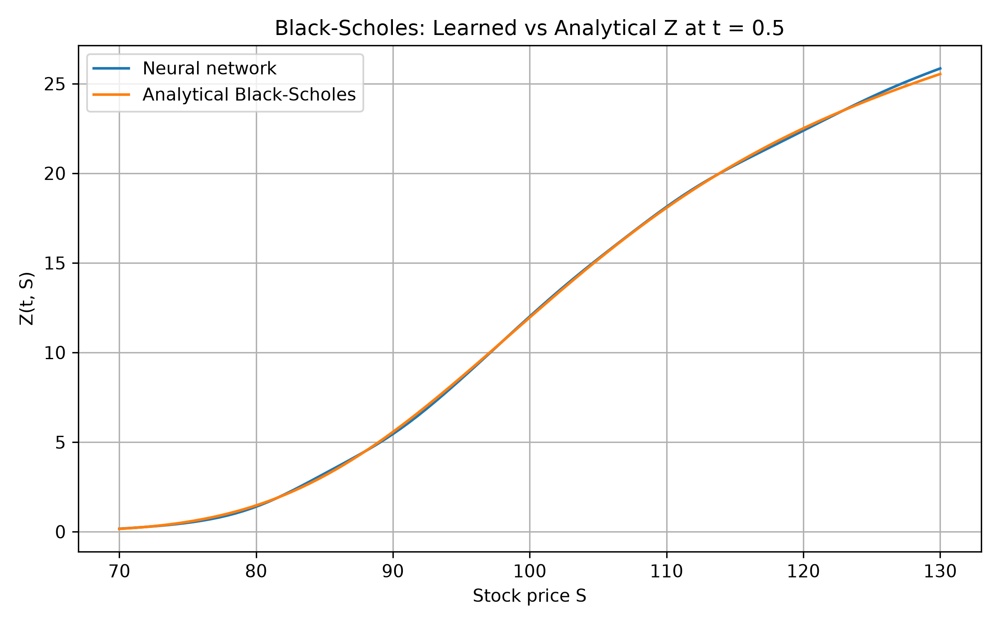
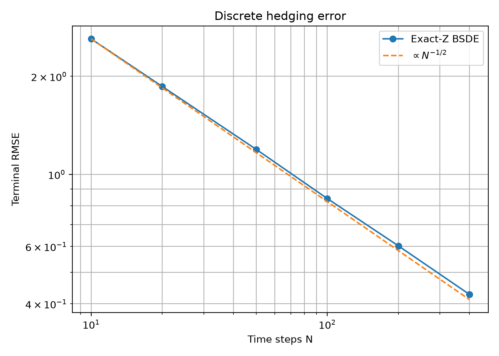
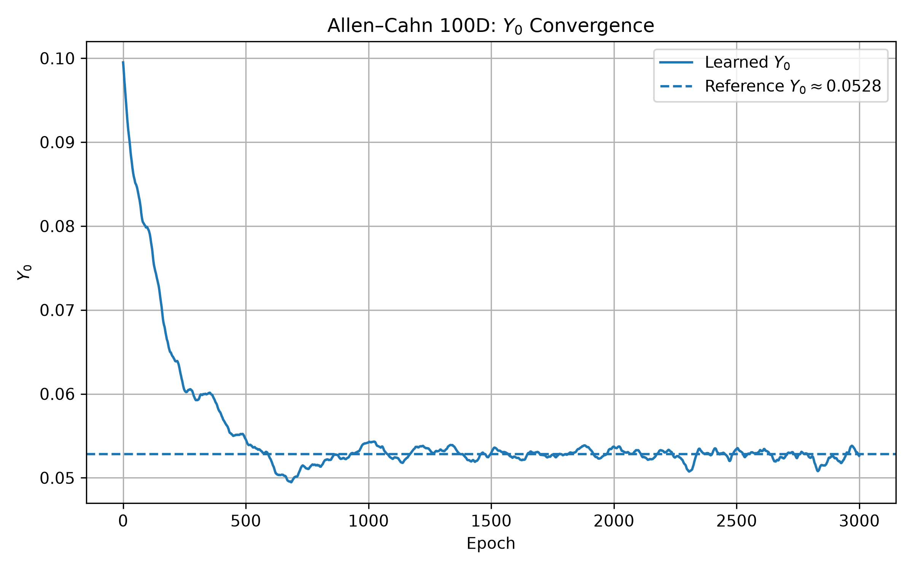

# Deep BSDE: solving pricing PDEs by learning the hedge

An implementation of the Deep BSDE method (Han, Jentzen & E, 2018), which solves parabolic PDEs by reformulating them as backward stochastic differential equations and training a neural network to represent the unknown gradient term. It is validated on Black-Scholes, where the exact answer is known, then applied to the 100-dimensional Allen-Cahn equation, where grid methods are infeasible and plain Monte Carlo does not apply.

## Method

For a PDE solution $u(t, x)$ along a forward process $X_t$, Itô's lemma turns the PDE into a pair of processes $Y_t = u(t, X_t)$ and $Z_t$, the gradient of $u$ scaled by the diffusion:

$$dY_t = -f(t, X_t, Y_t, Z_t)\,dt + Z_t \cdot dW_t, \qquad Y_T = g(X_T).$$

The method treats $Y_0$ as a trainable scalar and $Z_t$ as a neural network of $(t, X_t)$, simulates the recursion forward on Euler steps, and minimizes $\mathbb{E}\,|Y_T - g(X_T)|^2$. Because the $Z\,dW$ term has zero mean, $Y_0$ absorbs the mismatch in expectation and $Z$ absorbs the path-by-path variance; the loss is driven to its minimum only by the true $u(0, X_0)$ and the true $Z$.

## Experiments

### 1. Black-Scholes call (validation)

Under the risk-neutral measure the call price satisfies $dY = rY\,dt + Z\,dW$ with $Z = \sigma S\,\partial_S V$. Financially, $Y$ is the value of a self-financing portfolio holding $\Delta = Z/(\sigma S)$ shares, so training the network is learning the replicating hedge.

Setup: $S_0 = K = 100$, $r = 0.05$, $\sigma = 0.2$, $T = 1$, 50 time steps.

| | Value |
|---|---|
| Learned $Y_0$ | 10.4384 |
| Black-Scholes price | 10.4506 |
| Relative error | 0.12% |
| Terminal RMSE (network) | 1.257 |
| Terminal RMSE floor (exact $Z$, same $N$) | ≈ 1.19 |

The network's terminal error is within about 5% of the floor set by the exact analytic hedge, so nearly all of the remaining error comes from time discretization, not from learning.



The terminal error cannot reach zero even with a perfect network: holding $\Delta$ fixed over each step is discrete hedging, and its error shrinks like $N^{-1/2}$. `discretization_check.py` measures this floor using the exact analytic $Z$: the error falls from about 2.6 at $N = 10$ to 0.42 at $N = 400$, a factor of about 6.2 for 40× more steps ($\sqrt{40} \approx 6.3$).



### 2. Allen-Cahn in 100 dimensions

$$\partial_t u + \Delta u + u - u^3 = 0, \qquad u(T, x) = \frac{1}{2 + 0.4\lVert x\rVert^2}, \qquad T = 0.3,\ x \in \mathbb{R}^{100}.$$

The forward process is $X_t = \sqrt{2}\,W_t$ and the nonlinear driver is $f(y) = y - y^3$. The nonlinearity is what makes this case interesting: with a nonlinear driver, the Feynman-Kac formula no longer reduces the problem to a plain expectation, and a grid in 100 dimensions is out of the question.

| | Value |
|---|---|
| Learned $u(0, 0)$ | 0.05288 ± 0.00030 |
| Reference (Han, Jentzen & E) | 0.0528 |
| Relative error | 0.15% |
| Terminal RMSE (network) | 0.00535 |
| Terminal RMSE with $Z = 0$ | 0.0052 |

$u(0, 0)$ is reported as mean ± standard deviation of $Y_0$ over the last 500 training epochs, since single-epoch values fluctuate with the mini-batch.

**Initialization matters here.** Because $g$ is nearly flat around $\lVert X_T\rVert^2 \approx 60$, the true $Z$ is close to zero. With PyTorch's default initialization, the untrained network outputs $Z$ components of order 0.1, which injects noise through $Z \cdot dW$: the training run started at a loss of 0.29 and ended with a terminal RMSE of 0.035, about 7× worse than simply setting $Z = 0$. Zero-initializing the output layer cut the terminal RMSE to 0.0054, halved the fluctuation in $Y_0$, and made training converge about five times faster.

The learned $Z$ still does not beat the $Z = 0$ baseline: the variance it could explain (about $3 \times 10^{-5}$) is small compared with mini-batch noise at batch size 64. The quantity this benchmark targets, $u(0, 0)$, is accurate to 0.15%; the gradient is effectively zero on this problem. This contrasts with Black-Scholes, where $Z$ is large and the network learns it closely.



## Running

```bash
pip install -r requirements.txt
python black_scholes.py          # train, evaluate, plot  (--load to reuse a checkpoint)
python allen_cahn.py             # train, evaluate, plot  (--load to reuse a checkpoint)
python discretization_check.py   # exact-Z error vs number of steps
```

Requires Python 3.10+. Uses CUDA or Apple MPS if available, otherwise CPU.

## Files

| File | Contents |
|---|---|
| `bs_utils.py` | GBM simulation, Black-Scholes price and delta, BSDE step, Z network |
| `black_scholes.py` | Deep BSDE training and validation for the call |
| `allen_cahn.py` | Deep BSDE for 100D Allen-Cahn |
| `discretization_check.py` | Discrete hedging error with the exact Z |

## How this was built

A learning project from summer 2026. The training loops and plotting boilerplate were generated with AI assistance; the BSDE formulations, discretizations, and validation against analytic and reference solutions are my own work.

## Reference

J. Han, A. Jentzen, W. E. *Solving high-dimensional partial differential equations using deep learning.* PNAS 115(34), 2018.
